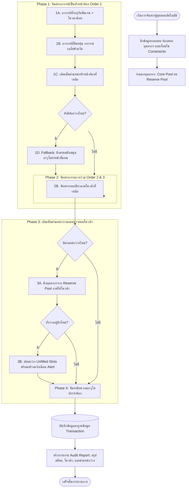

# เอกสารข้อกำหนด กฎระเบียบ และการกำหนดโควต้าในการจัดสรรผู้คุมสอบ (ELMS Proctor Scheduling Rules & Quota Management Specification)

**ระบบบริหารจัดการศูนย์สอบและผู้คุมสอบ (Examination Center Room & Proctor Management System: ELMS)**  
**หน่วยงาน:** ศูนย์สอบมหาวิทยาลัยราชภัฏบุรีรัมย์ อาคารนวัตปัญญา (อาคาร 17)  
**เวอร์ชันเอกสาร:** 1.0 (สมบูรณ์)  
**วันที่ประกาศใช้/ปรับปรุงล่าสุด:** 26 ตุลาคม 2569  

---

## 1. บทนำและวัตถุประสงค์ (Overview & Objectives)

### 1.1 ความเป็นมาและบริบทของศูนย์สอบ
ศูนย์สอบมหาวิทยาลัยราชภัฏบุรีรัมย์ (อาคารนวัตปัญญา อาคาร 17) เป็นศูนย์ทดสอบมาตรฐานระดับภูมิภาคที่รองรับการจัดสอบสำคัญระดับประเทศ เช่น การสอบวัดความรู้ความสามารถทั่วไปของสำนักงาน ก.พ. (Paper & Pencil และ e-Exam), การทดสอบของสำนักงานเลขาธิการคุรุสภา, และการทดสอบวัดสมรรถนะทางวิชาการและวิชาชีพต่าง ๆ โดยศูนย์สอบประกอบด้วย **10 ห้องสอบมาตรฐาน ความจุรวม 520 ที่นั่ง** และต้องใช้อัตรากำลังผู้คุมสอบจำนวน **21 ตำแหน่งต่อหนึ่งรอบการสอบ**

### 1.2 วัตถุประสงค์ของเอกสาร
เอกสารฉบับนี้จัดทำขึ้นเพื่อรวบรวมและกำหนดมาตรฐาน **กฎ ระเบียบ เงื่อนไขบังคับ (Constraints) และหลักเกณฑ์การจัดสรรโควต้า (Quota Allocation)** สำหรับการจัดตารางผู้คุมสอบ เพื่อใช้เป็น:
1. **เกณฑ์มาตรฐานการปฏิบัติงาน (Standard Operating Procedure: SOP)** ของคณะกรรมการบริหารศูนย์สอบและเจ้าหน้าที่ผู้ดูแลระบบ
2. **ข้อกำหนดเชิงตรรกะและอัลกอริธึม (Algorithmic Specification)** สำหรับระบบประมวลผลจัดตารางอัตโนมัติ (Intelligent Auto-Scheduler Engine) และโมเดลความพึงพอใจของเงื่อนไข (Constraint Satisfaction Problem: CSP)
3. **กรอบการดำเนินงานที่โปร่งใส ตรวจสอบได้ และเป็นธรรม (Transparency, Accountability & Fairness)** แก่อาจารย์และบุคลากรทุกท่านที่ปฏิบัติหน้าที่คุมสอบ

---

## 2. โครงสร้างกายภาพและเกณฑ์อัตรากำลังประจำห้องสอบ (Physical Structure & Staffing Standards)

### 2.1 ตารางมาตรฐาน 10 ห้องสอบ อาคารนวัตปัญญา (520 ที่นั่ง)

| ลำดับ | เลขห้องสอบ | ชั้น | โต๊ะลงทะเบียน | ช่วงเลขที่นั่งสอบ | ความจุ (ที่นั่ง) | จำนวนผู้คุมสอบที่ต้องมี | สัดส่วนบทบาทหน้าที่ |
| :---: | :---: | :---: | :---: | :---: | :---: | :---: | :--- |
| 1 | **17108** | 1 | โต๊ะที่ 1 | 001 - 040 | 40 | 2 คน | หัวหน้าห้อง 1 คน, กรรมการร่วม 1 คน |
| 2 | **17109** | 1 | โต๊ะที่ 2 | 041 - 100 | 60 | 2 คน | หัวหน้าห้อง 1 คน, กรรมการร่วม 1 คน |
| 3 | **17110** | 1 | โต๊ะที่ 3 | 101 - 160 | 60 | 2 คน | หัวหน้าห้อง 1 คน, กรรมการร่วม 1 คน |
| 4 | **17111** | 1 | โต๊ะที่ 4 | 161 - 210 | 50 | 2 คน | หัวหน้าห้อง 1 คน, กรรมการร่วม 1 คน |
| 5 | **17201** | 2 | โต๊ะที่ 5 | 211 - 290 | **80** | **3 คน** | **หัวหน้าห้อง 1 คน, กรรมการร่วม 2 คน** |
| 6 | **17205** | 2 | โต๊ะที่ 6 | 291 - 330 | 40 | 2 คน | หัวหน้าห้อง 1 คน, กรรมการร่วม 1 คน |
| 7 | **17206** | 2 | โต๊ะที่ 7 | 331 - 370 | 40 | 2 คน | หัวหน้าห้อง 1 คน, กรรมการร่วม 1 คน |
| 8 | **17211** | 2 | โต๊ะที่ 8 | 371 - 420 | 50 | 2 คน | หัวหน้าห้อง 1 คน, กรรมการร่วม 1 คน |
| 9 | **17212** | 2 | โต๊ะที่ 9 | 421 - 472 | 52 | 2 คน | หัวหน้าห้อง 1 คน, กรรมการร่วม 1 คน |
| 10 | **17213** | 2 | โต๊ะที่ 10 | 473 - 520 | 48 | 2 คน | หัวหน้าห้อง 1 คน, กรรมการร่วม 1 คน |
| **รวม** | **10 ห้อง** | - | **10 จุด** | **001 - 520** | **520** | **21 คน** | **หัวหน้าห้อง 10 คน, กรรมการร่วม 11 คน** |

### 2.2 เกณฑ์การกำหนดจำนวนผู้คุมสอบ (Staffing Threshold Rule)
1. **ห้องสอบขนาดทั่วไป (ความจุ $< 70$ ที่นั่ง):** กำหนดให้มีผู้คุมสอบประจำห้อง **2 คน** (Order Index: 1 และ 2)
2. **ห้องสอบขนาดใหญ่ (ความจุ $\ge 70$ ที่นั่ง — ห้อง 17201):** กำหนดให้มีผู้คุมสอบประจำห้อง **3 คน** (Order Index: 1, 2 และ 3) เพื่อให้ครอบคลุมผังห้องแบบโรงภาพยนตร์ (Cinema Tiered Layout)
3. **อัตรากำลังรวมต่อ 1 รอบสอบ:** 21 คนต่อรอบ (เช้า 21 คน, บ่าย 21 คน หากมีการสอบทั้งวัน คิดเป็น 42 สล็อตต่อวัน)

### 2.3 บทบาทหน้าที่และความรับผิดชอบในห้องสอบ (Role Hierarchy)
* **กรรมการคนที่ 1 (Lead Proctor / หัวหน้าห้องสอบ - `orderIndex = 1`):**
  - เป็นหัวหน้าคณะกรรมการประจำห้องสอบ
  - รับ-ส่งแบบทดสอบ กระดาษคำตอบ และเอกสารลับจากกองอำนวยการศูนย์สอบ
  - กำกับดูแลเวลาเปิด-ปิดการสอบ ชี้แจงระเบียบปฏิบัติหน้าห้อง และตรวจนับยอดกระดาษคำตอบให้ครบถ้วน 100%
  - บันทึกรายงานเหตุการณ์ผิดปกติ การทุจริต หรืออุบัติเหตุในห้องสอบ และลงนามในเอกสารราชการ
* **กรรมการคนที่ 2 และ 3 (Co-Proctor / กรรมการร่วมคุมสอบ - `orderIndex = 2, 3`):**
  - ตรวจสอบบัตรประจำตัวประชาชน/บัตรประจำตัวผู้สอบ และลายมือชื่อผู้เข้าสอบให้ตรงกับใบเซ็นชื่อ
  - เดินตรวจตราความเรียบร้อย สังเกตพฤติกรรม ป้องกันการทุจริต และดูแลไม่ให้ผู้เข้าสอบกระทำผิดระเบียบ
  - ช่วยเหลือหัวหน้าห้องในการแจก-เก็บข้อสอบ และจัดเรียงกระดาษคำตอบตามลำดับเลขที่สอบ

---

## 3. การจำแนกประเภทบุคลากรและโครงสร้างกลุ่มทรัพยากร (Staff Classification & Pool Architecture)

### 3.1 การจำแนกตามสถานภาพบุคลากร (Staff Category)
1. **บุคลากรสายวิชาการ (Academic Staff / อาจารย์):**
   - ดำรงตำแหน่งอาจารย์, ผู้ช่วยศาสตราจารย์ (ผศ.), รองศาสตราจารย์ (รศ.), หรือศาสตราจารย์ (ศ.)
   - มีคุณสมบัติหลักในการเป็น **"หัวหน้าห้องสอบ (กรรมการคนที่ 1)"**
2. **บุคลากรสายสนับสนุน (Support Staff):**
   - เจ้าหน้าที่สายสนับสนุนวิชาการ บุคลากรประจำสำนัก/สถาบัน/กอง/คณะ
   - ปฏิบัติหน้าที่ในฐานะ **"กรรมการร่วมคุมสอบ (กรรมการคนที่ 2 หรือ 3)"** เป็นหลัก
   - สามารถปฏิบัติหน้าที่เป็นหัวหน้าห้องสอบได้เฉพาะกรณีมีเหตุจำเป็นเร่งด่วน หรือบุคลากรสายวิชาการในรอบนั้นไม่เพียงพอจริง ๆ (Fallback Policy)

### 3.2 ลำดับความอาวุโสทางวิชาการและตำแหน่งงาน (Seniority Ranking System)
เพื่อใช้ในการคัดสรรหัวหน้าห้องสอบในกรณีที่มีอาจารย์หลายท่านในห้องเดียวกัน ระบบใช้เกณฑ์น้ำหนักความอาวุโสดังนี้:

| ระดับความอาวุโส (Rank Score) | กลุ่มตำแหน่ง / คำนำหน้าทางวิชาการ | ตัวอย่างตำแหน่งงานจริงในระบบ มรภ.บุรีรัมย์ |
| :---: | :--- | :--- |
| **10** | ศาสตราจารย์ (ศ. / ศ.ดร.) | ศาสตราจารย์ |
| **9** | รองศาสตราจารย์ (รศ. / รศ.ดร.) | รองศาสตราจารย์ |
| **8** | ผู้ช่วยศาสตราจารย์ (ผศ. / ผศ.ดร.) | ผู้ช่วยศาสตราจารย์ |
| **7** | อาจารย์ (อาจารย์ / อาจารย์ ดร. / อ.) | อาจารย์, ครูวิทยฐานะชำนาญการ |
| **5** | บุคลากรสายสนับสนุน ระดับชำนาญการพิเศษ | นักวิชาการคอมพิวเตอร์ชำนาญการพิเศษ |
| **4** | บุคลากรสายสนับสนุน ระดับชำนาญการ | เจ้าหน้าที่บริหารงานทั่วไปชำนาญการ |
| **3** | บุคลากรสายสนับสนุน ระดับปฏิบัติการ / ทั่วไป | เจ้าหน้าที่ปฏิบัติการ, พนักงานมหาวิทยาลัยทั่วไป |

### 3.3 สถาปัตยกรรมกลุ่มบุคลากร (Staff Pools)
* **Core Pool (กลุ่มบุคลากรหลัก):** บุคลากรที่ผ่านการตอบรับแบบสำรวจความพร้อม หรือผ่านการคัดสรรจากคณะ/หน่วยงานให้เป็นรายชื่อหลักในการจัดสรรโครงการสอบนั้น ๆ ระบบจะดึงบุคลากรกลุ่มนี้มาจัดสรรในรอบที่ 1 ถึงรอบที่ 3 เสมอ
* **Reserve Pool (กลุ่มบุคลากรสำรอง):** บุคลากรสำรองที่พร้อมถูกดึงมาเติมเต็ม (Gap-filling) ในกรณีที่บุคลากรใน Core Pool มีจำนวนไม่เพียงพอกับสล็อตที่เปิด หรือเพื่อทดแทนกรณีมีคำขอสลับตัว/ลาฉุกเฉิน

---

## 4. กฎและเงื่อนไขบังคับเด็ดขาด (Hard Constraints) — ห้ามละเมิด 100%

เงื่อนไขบังคับเด็ดขาดต้องมีความถูกต้องสมบูรณ์ (Violation Rate = 0%) หากระบบตรวจพบการละเมิด ระบบจะปฏิเสธการบันทึกหรือระงับการจัดสรรทันที:

```
[Hard Constraint 1: No Overlap]
ผู้คุมสอบ 1 ท่าน ห้ามปฏิบัติหน้าที่เกิน 1 ห้องสอบ ในช่วงเวลา/รอบสอบเดียวกัน
∀ r1 ≠ r2, Assignment(staff, session, r1) ∧ Assignment(staff, session, r2) = False

[Hard Constraint 2: Strict Quota Limit]
ห้ามจัดสรรภาระงานเกินกว่าโควตาสูงสุดที่ระบุไว้เด็ดขาด
Count(AssignedSessions(staff)) ≤ staff.maxSessions
*กรณี staff.maxSessions เป็น null, undefined หรือ ≤ 0 ห้ามจัดลงรอบสอบเด็ดขาด

[Hard Constraint 3: Strict Date/Session Availability]
กรณีบุคลากรระบุวัน/รอบสอบเฉพาะเจาะจง ห้ามจัดสรรลงในวันหรือรอบอื่นนอกเหนือจากที่ระบุ
session ∉ staff.availableDates ⇒ Assignment(staff, session, room) = False

[Hard Constraint 4: Single per Day Pattern Enforcement]
กรณีบุคลากรมีเงื่อนไข sessionPattern = 'SINGLE_PER_DAY' ห้ามจัดคุมทั้งรอบเช้าและรอบบ่ายในวันเดียวกัน
SessionDate(s1) = SessionDate(s2) ∧ s1 ≠ s2 ⇒ ¬(Assigned(staff, s1) ∧ Assigned(staff, s2))

[Hard Constraint 5: Room Staffing Threshold]
ทุกห้องสอบที่เปิดใช้งาน ต้องมีจำนวนผู้คุมสอบครบตามความจุ (40-60 ที่นั่ง = 2 คน, 80 ที่นั่ง = 3 คน)
```

---

## 5. กฎและเงื่อนไขความพึงพอใจ: อัลกอริธึมจัดสรร 5 ลำดับความสำคัญ (Intelligent 5-Priority Engine)

ระบบ ELMS ใช้กลไกการจัดสรรแบบหลายรอบ (Multi-Pass Constraint Scheduling Engine) โดยเรียงลำดับความสำคัญตามกฎ 5 ข้อ ดังนี้:

### กฎข้อที่ 1: นำคนที่โควต้าน้อยจัดลงก่อน (Lower Quota First)
* **หลักการ:** บุคลากรที่มีโควตารอบสอบน้อย (เช่น สะดวกเพียง 1 หรือ 2 รอบ) จะมีโอกาสหาที่ลงได้ยากกว่าหากปล่อยให้เวลาผ่านไป ดังนั้นระบบจะนำผู้ที่มีโควตาน้อยมาจัดสรรลงห้องสอบก่อนเพื่อปิดโควต้าให้ครบถ้วน 100% ไม่ให้เกิดปัญหาเศษโควต้าตกค้าง
* **การเรียงลำดับ:** จัดเรียงผู้สมัครตาม `maxSessions` จากน้อยไปมาก (Ascending Order)

### กฎข้อที่ 2: คนที่ระบุวันลงชัดเจนก่อน (Explicit Date Availability First)
* **หลักการ:** บุคลากรที่ระบุวันสอบจำเพาะเจาะจง (เช่น มาได้เฉพาะวันที่ 28 มีนาคม) มีความยืดหยุ่นต่ำกว่าผู้ที่สะดวกทุกวัน ระบบจะจัดสรรผู้ที่ระบุวันลงในวันนั้น ๆ ให้เสร็จสิ้นก่อน เพื่อไม่ให้โควต้าเฉพาะวันสูญเปล่า และสงวนผู้ที่สะดวกทุกวันไว้กระจายลงในวันที่ขาดแคลน
* **การเรียงลำดับ:** `hasExplicitDates = true` ได้รับสิทธิ์จัดสรรก่อน `hasExplicitDates = false`

### กฎข้อที่ 3: จัดตามเงื่อนไขรายบุคคลก่อนจึงใช้เงื่อนไขหลัก (Individual Preference Priority)
* **รูปแบบกะการทำงาน (Session Patterns):**
  - `FULL_DAY_PAIRED` (เช้า + บ่าย): จัดลงรอบเช้าและบ่ายในวันเดียวกัน และ **จัดให้อยู่ห้องสอบเดิม (Room Stickiness: `keepSameRoom = true`)** เพื่อความสะดวก ลดการย้ายอุปกรณ์ และเพิ่มความคุ้นเคยกับห้องสอบ
  - `SINGLE_PER_DAY`: คุมวันละ 1 รอบเท่านั้น (เช้าหรือบ่าย)
  - `ANY`: ยืดหยุ่นตามที่ระบบพิจารณาเหมาะสม
* **การคงห้องเดิม (Room Continuity):** หากอาจารย์คุมสอบทั้งเช้าและบ่ายในวันเดียวกัน ระบบจะให้คะแนนพิเศษ (Bonus Score) เพื่อให้อาจารย์ประจำการห้องเดิมตลอดทั้งวัน

### กฎข้อที่ 4: กำหนดให้อาจารย์เป็นหลัก 1 คนทุกห้อง (Mandatory Academic Lead Proctor)
* **หลักการ:** ตำแหน่งหัวหน้าห้อง (`orderIndex = 1`) ในทุกห้องสอบและทุกรอบสอบ จะต้องจัดสรรให้เป็น **อาจารย์ (สายวิชาการ)** เท่านั้น
* **กลไกกระจายอาจารย์ข้ามวัน (Academic Lead Balancing across Days):**
  - เพื่อป้องกันไม่ให้อาจารย์ถูกจัดเต็มตั้งแต่วันแรกจนหมดโควต้าในวันหลัง ระบบจะประเมินจำนวนอาจารย์ต่อวัน และจัดสรรให้อาจารย์กระจายตัวอย่างสมดุลเท่ากันทุกวันสอบ
* **การคัดเลือกตามความอาวุโส (Seniority Ranking):**
  - ในการจัดตำแหน่งหัวหน้าห้อง อาจารย์ที่มีตำแหน่งวิชาการสูงกว่า (ศ. > รศ. > ผศ. > อาจารย์) จะได้รับการพิจารณาให้อยู่ในลำดับหัวหน้าห้องตามความเหมาะสม

### กฎข้อที่ 5: หากไม่มีคนจริง ๆ จึงจะสามารถจัดบุคลากรสายสนับสนุนเข้าห้องสอบอีกครั้ง (Fallback & Alert Policy)
* **หลักการแก้ไขปัญหาอัตรากำลังไม่เพียงพอ:**
  1. หากอาจารย์ใน Core Pool ไม่เพียงพอสำหรับตำแหน่งหัวหน้าห้อง ระบบจึงจะอนุญาตให้ใช้บุคลากรสายสนับสนุนที่มีอาวุโสสูงเข้าทำหน้าที่หัวหน้าห้องแทน (Lead Support Fallback)
  2. หากบุคลากรใน Core Pool หมดโควต้าแล้ว แต่ยังมีตำแหน่งกรรมการร่วมว่างอยู่ ระบบจะดึงบุคลากรจาก **กลุ่มสำรอง (Reserve Pool)** เข้ามาเติมเต็มตำแหน่งว่าง
  3. **การป้องกันการจัดซ้ำเกินโควต้า (No Forced Over-Quota):** หากบุคลากรทั้ง Core และ Reserve Pool หมดโควต้าแล้ว ระบบ **ห้ามนำบุคลากรเดิมมาวนคุมซ้ำจนเกินโควต้าโดยพลการเด็ดขาด** ระบบจะต้อง **"ปล่อยว่างตำแหน่งที่ขาด (Unfilled Slots) พร้อมส่งแจ้งเตือน (Alert Summary)"** ในหน้ารายงาน Audit เพื่อให้ผู้ดูแลระบบรับทราบและดึงบุคลากรเพิ่มอย่างถูกต้องตามระเบียบ

---

## 6. นโยบายการกำหนดโควต้าและการสร้างความเป็นธรรม (Quota Policy & Workload Fairness)

### 6.1 การกำหนดโควต้าภาระงาน (Workload Quota Guidelines)
1. **โควต้ามาตรฐาน (Standard Quota):** ศูนย์สอบแนะนำให้บุคลากร 1 ท่าน มีภาระงานคุมสอบเฉลี่ย **2 - 4 รอบสอบต่อโครงการ** (เช่น วันเสาร์เต็มวัน 2 รอบ หรือ เสาร์-อาทิตย์ วันละ 2 รอบ รวม 4 รอบ)
2. **โควตาสูงสุด (Ceiling Limit):** ห้ามบุคลากรคุมสอบเกิน **6 รอบต่อโครงการสอบ** (เว้นแต่กรณีการสอบยืดเยื้อหลายสัปดาห์และได้รับอนุมัติเป็นกรณีพิเศษ) เพื่อป้องกันความเหนื่อยล้า (Fatigue Risk) ที่อาจส่งผลกระทบต่อประสิทธิภาพการตรวจตรา
3. **การบันทึกค่าโควต้า:** หากบุคลากรไม่ประสงค์ปฏิบัติหน้าที่ หรือติดภาระงานอื่น ระบบจะบันทึก `maxSessions = 0` ซึ่งระบบจะข้ามการจัดสรรโดยอัตโนมัติ

### 6.2 ดัชนีวัดความเป็นธรรมของการกระจายงาน (Workload Fairness Index)
ระบบประเมินความเป็นธรรมของการจัดสรรภาระงานโดยใช้เกณฑ์ทางสถิติ:
* **ส่วนเบี่ยงเบนมาตรฐานของภาระงาน (Standard Deviation of Duties):** ยิ่งมีค่าน้อย แสดงว่าภาระงานกระจายตัวเท่าเทียมกัน
* **Jain's Fairness Index ($J$):** คำนวณจากจำนวนรอบสอบที่ได้รับจัดสรรจริง ($x_i$) ของบุคลากรแต่ละคน:
  $$J = \frac{(\sum_{i=1}^{n} x_i)^2}{n \cdot \sum_{i=1}^{n} x_i^2}$$
  - ค่า $J$ อยู่ระหว่าง 0 ถึง 1 โดยระบบตั้งเป้าหมายค่าความเป็นธรรม $J \ge 0.85$ สำหรับกลุ่มบุคลากรหลัก

---

## 7. กฎการสลับตัวผู้คุมสอบแบบพลวัต (Dynamic Proctor Swapping & Constraint Preservation)

ในกรณีที่ผู้คุมสอบติดภาระกิจด่วน มีอาการเจ็บป่วย หรือเหตุสุดวิสัย ระบบ ELMS รองรับการยื่นคำขอสลับตัวผ่านสมาร์ตโฟน (Proctor Mobile Web) โดยมีกฎระเบียบควบคุมอย่างเคร่งครัด:

```
[กระบวนการยื่นคำขอและตรวจสอบการสลับตัว]
ผู้คุมสอบเดิม (Requester) ──> เลือกผู้คุมสอบแทน (Substitute) ──> ระบุเหตุผลจำเป็น
                                            │
                                            ▼
                    [ระบบ ELMS ตรวจสอบเงื่อนไขอัตโนมัติ (Validation)]
                    1. ผู้รับสลับต้องไม่มีเวรคุมสอบในรอบนั้น (No Overlap)
                    2. ภาระงานรวมของผู้รับสลับต้องไม่เกินโควต้า (Within Quota)
                    3. ตรวจสอบคุณสมบัติหัวหน้าห้อง (Academic Role Compatibility)
                    4. ป้องกันการกระทบเป็นลูกโซ่ (Domino Effect Prevention)
                                            │
                                            ▼
                    ผู้ดูแลระบบ (Admin) ตรวจสอบและกดอนุมัติ (Approve)
                                            │
                                            ▼
           ระบบออก "บันทึกข้อความขอเปลี่ยนแปลงผู้คุมสอบ (.docx)" เสนออธิการบดี
```

### 7.1 กฎการตรวจสอบคุณสมบัติผู้รับสลับ (Substitute Validation Rules)
1. **ความพร้อมด้านเวลา (Time Availability):** ผู้รับสลับต้องไม่มีตารางคุมสอบในห้องใด ๆ ในรอบสอบเดียวกันนั้น
2. **การคงสัดส่วนหัวหน้าห้อง (Lead Proctor Qualification Preservation):**
   - หากผู้ขอยื่นสลับเป็น **หัวหน้าห้องสอบ (กรรมการคนที่ 1 - อาจารย์)** ผู้รับสลับ **จะต้องเป็นอาจารย์** เช่นเดียวกัน เพื่อรักษามาตรฐานทางวิชาการและการควบคุมห้องสอบ
   - หากมีความจำเป็นต้องให้สายสนับสนุนรับหน้าที่แทน ต้องได้รับการพิจารณาอนุมัติเป็นกรณีพิเศษจากประธานศูนย์สอบ
3. **การคงเพดานโควต้า (Quota Preservation):** การรับสลับต้องไม่ทำให้ภาระงานรวมของผู้รับสลับเกินกว่าโควตาสูงสุดที่ระบุไว้
4. **การป้องกันผลกระทบลูกโซ่ (Domino Effect Prevention):** การสลับตัวต้องมีผลกระทบเฉพาะตำแหน่งที่ระบุเท่านั้น ห้ามกระทบหรือสับเปลี่ยนตำแหน่งของผู้คุมสอบท่านอื่นในห้องสอบเดียวกัน

### 7.2 ขั้นตอนทางสารบรรณและเอกสารราชการ
เมื่อผู้ดูแลระบบอนุมัติคำขอสลับตัวในระบบ:
1. ระบบจะอัปเดตรายชื่อในฐานข้อมูลตารางคุมสอบ และปรับผังใบเซ็นชื่อหน้าห้องสอบอัตโนมัติ
2. ระบบ Nitro Engine จะประมวลผลเทมเพลตและสร้างไฟล์ **"บันทึกข้อความขอเปลี่ยนแปลงผู้คุมสอบ (.docx)"** อัตโนมัติ โดยระบุชื่อผู้ขอเปลี่ยน, ผู้ปฏิบัติหน้าที่แทน, เหตุผลความจำเป็น, ห้องสอบ และรอบสอบ เพื่อเสนอให้อธิการบดีหรือรองอธิการบดีลงนามตามระเบียบมหาวิทยาลัย

---

## 8. กระบวนการตรวจสอบและรายงานการจัดตาราง (Audit Report & Exception Handling)

หลังการประมวลผลจัดสรรอัตโนมัติทุกครั้ง ระบบจะจัดทำ **รายงานการตรวจสอบความถูกต้อง (Scheduling Audit Report)** แสดงรายละเอียดดังนี้:

| รายการตรวจสอบ | เกณฑ์มาตรฐาน | การดำเนินการเมื่อไม่ผ่านเกณฑ์ |
| :--- | :---: | :--- |
| **อัตราความครอบคลุม (Coverage Rate)** | 100% (ครบทุกตำแหน่ง) | หาก $< 100\%$ ให้ตรวจสอบรายการ Unfilled Slots เพื่อดึงบุคลากรเพิ่ม |
| **การละเมิดเงื่อนไขบังคับ (Hard Violations)** | 0% (ต้องไม่มีการละเมิด) | ระบบปฏิเสธการจัดตารางและย้อนกลับสถานะเดิม |
| **สัดส่วนอาจารย์คุมหลัก (Lead Teacher Coverage)** | 100% (10 ห้องทุกรอบ) | หากมี Fallback ให้แจ้งเตือนผู้บริหารเพื่อเติมอาจารย์ในรอบนั้น |
| **การใช้กลุ่มสำรอง (Reserve Pool Count)** | ตามความจำเป็น | ตรวจสอบว่ามีบุคลากรหลักขาดกี่ตำแหน่ง |
| **ตำแหน่งที่ยังว่าง (Unfilled Slots)** | 0 ตำแหน่ง | แจ้งเตือนแอดมินพร้อมระบุ วัน เวลา ห้อง และลำดับกรรมการที่ขาด |

---

## 9. สรุปแผนผังการประมวลผล (Algorithm Workflow Diagram)



---

## 10. เอกสารอ้างอิงและไฟล์ที่เกี่ยวข้อง (Related Documents & Source Code)
1. `h:\My Drive\#ARIT-GDrive\ศูนย์สอบ\ระบบELMS-เอกสาร\แนวทางงานวิจัย-CSP-ELMS.md` — กรอบแนวคิดเชิงวิจัย CSP และ ETP
2. `h:\My Drive\#ARIT-GDrive\ศูนย์สอบ\ระบบELMS-เอกสาร\Room\แผนผังห้องสอบที่-1-10.pdf` — พิมพ์เขียวผัง 10 ห้องสอบ 520 ที่นั่ง
3. `d:\Project\elms\server\utils\schedulerEngine.ts` — ซอร์สโค้ดเอนจินจัดตารางผู้คุมสอบอัตโนมัติ 5 ลำดับความสำคัญ
4. `d:\Project\elms\prisma\schema.prisma` — โครงสร้างฐานข้อมูล `Staff`, `ProctorConstraint`, `ProctorAssignment` และ `SwapRequest`
5. `d:\Project\elms\server\utils\docGenerator.ts` — โมดูลสร้างคำสั่งแต่งตั้งและบันทึกข้อความขอสลับตัวผู้คุมสอบ (.docx)
