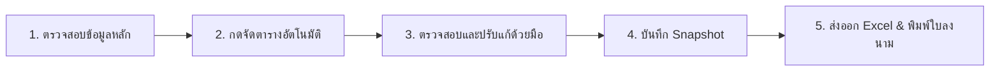

# 📖 คู่มือการใช้งานระบบจัดตารางผู้คุมสอบ (User Guide สำหรับผู้ประสานงานสอบ)

ระบบจัดตารางผู้คุมสอบถูกออกแบบขึ้นมาเป็นพิเศษสำหรับ **ผู้ประสานงานสอบ (Admin)** ที่ไม่ใช่โปรแกรมเมอร์ ใช้งานง่าย ภาษาไทยทั้งหมด ช่วยให้การวางแผนและจัดตารางผู้คุมสอบเป็นเรื่องง่าย รวดเร็ว และไม่มีข้อผิดพลาด

---

## 1. วิธีเริ่มต้นใช้งานระบบ (เปิดได้ด้วยคลิกเดียว)

1. เข้าไปที่โฟลเดอร์โปรเจกต์ `exam-proctor-scheduler`
2. **ดับเบิลคลิกไฟล์ `start.bat`** (หรือรันคำสั่ง `.\server.ps1` ใน PowerShell)
3. ระบบจะเปิดเว็บเบราว์เซอร์ให้อัตโนมัติที่หน้า `http://localhost:8080` พร้อมใช้งานได้ทันทีโดยไม่ต้องติดตั้งโปรแกรมเสริมใดๆ

---

## 2. ขั้นตอนการทำงานหลัก (Workflow)

### ขั้นตอนที่ 1: ตรวจสอบข้อมูลหลัก (Master Data)
- คลิกเมนู **"ข้อมูลหลัก"** ทางแถบซ้ายมือ
- สามารถดูและแก้ไขรายชื่อ **ผู้คุมสอบ, ห้องสอบ, รอบการสอบ, และช่วงเวลาที่แจ้งไม่ว่าง**
- **ดาวน์โหลดแม่แบบ CSV** หรือนำเข้าไฟล์ Excel/CSV ที่จัดเตรียมไว้ได้
- มีสวิตช์ **"ซ่อนข้อมูลส่วนบุคคล (PDPA)"** เพื่อความปลอดภัยในการนำเสนอรายชื่อ

### ขั้นตอนที่ 2: จัดตารางอัตโนมัติ (Auto-Schedule)
- ในหน้า **"แดชบอร์ด"** หรือ **"ตารางผู้คุมสอบ"** คลิกปุ่มสีน้ำเงิน **"⚡ เริ่มจัดตารางอัตโนมัติ"**
- ระบบจะคำนวณและจัดสรรผู้คุมให้ครบทุกห้อง ทุกรอบ โดย:
  - เคารพกฎเด็ดขาด H1-H8 (ไม่มีการซ้อนเวลา, ไม่เกินโควต้า, ทุกห้องมีหัวหน้าห้อง, มีเวลาพัก 30 นาที)
  - กระจายภาระงานให้อาจารย์และเจ้าหน้าที่อย่างเป็นธรรม (คะแนน Soft Constraints)
  - จัดผู้คุมสำรองประจำรอบละ 2 คนโดยอัตโนมัติ

### ขั้นตอนที่ 3: ตรวจสอบและสลับมุมมอง 3 แบบ
ในหน้า **"ตารางผู้คุมสอบ"** สามารถเลือกดูได้ 3 มุมมอง:
1. **⊞ ตามรอบ x ห้อง (กริด):** ดูภาพรวมของแต่ละห้องสอบในแต่ละรอบ ใครเป็นหัวหน้าห้อง ใครเป็นผู้ช่วย
2. **👤 รายบุคคล (ปฏิทิน):** ค้นหาชื่อผู้คุมเพื่อดูว่าแต่ละคนต้องมาวันไหน เวลาใดบ้าง
3. **📊 สรุปภาระงาน (กราฟ):** ดูว่าแต่ละคนคุมไปแล้วกี่รอบ เทียบกับโควต้าสูงสุด

### ขั้นตอนที่ 4: การแก้ไขด้วยตนเอง (Manual Override) & กรณีลากะทันหัน
- **คลิกที่ชื่อผู้คุมในช่องใดก็ได้:** เพื่อเปิดหน้าต่างเปลี่ยนตัว
  - ระบบจะแสดง **"รายชื่อตัวแทนที่แนะนำ"** ที่มีเวลาว่างและผ่านกฎเกณฑ์ เรียงตามคะแนนความเหมาะสม
  - สามารถกดปุ่ม **"🔒 ล็อกตำแหน่งนี้"** เพื่อไม่ให้อัลกอริทึมเปลี่ยนคนนี้ในการจัดรอบถัดไป
  - มีปุ่ม **"↩️ ย้อนกลับ (Undo)"** รองรับสูงสุด 30 ขั้น หากเปลี่ยนใจ
- **กรณีมีผู้คุมลากะทันหัน:**
  - คลิกปุ่มสีแดง **"🚑 แจ้งผู้คุมลากะทันหัน"**
  - เลือกรอบและชื่อคนที่ลา ระบบจะเสนอ **"ผู้คุมสำรองประจำรอบ"** ให้กดเข้าแทนได้ทันที

### ขั้นตอนที่ 5: การส่งออกเอกสารราชการ (Export)
- **📗 ส่งออก Excel (.xlsx):** คลิกปุ่ม Excel บนแถบขวาบน จะได้ไฟล์ตาราง 4 ชีต (ตารางรวม, รายคน, รายห้อง, สรุปภาระงาน) ภาษาไทยถูกต้อง 100%
- **🖨️ พิมพ์ใบลงนามผู้คุมสอบ (PDF):** คลิกปุ่ม "พิมพ์ใบลงนาม" ระบบจะสร้างฟอร์มหนังสือราชการพร้อมตารางลงลายมือชื่อ เวลามา-กลับ รายห้อง พร้อมสั่งพิมพ์หรือ Save as PDF ได้ทันที

---

## 3. ความหมายของสีและสัญลักษณ์

| สัญลักษณ์ | ความหมาย | สิ่งที่ต้องทำ |
|---|---|---|
| 🟢 **สีเขียว** (ปกติ) | ผ่านเกณฑ์กฎทุกข้อ ภาระงานสมดุล | ใช้งานได้ทันที |
| 🟡 **สีส้ม** (ใกล้เต็มโควต้า) | ผู้คุมได้รับงานใกล้ชนเพดานโควต้า | ตรวจสอบว่ามีคนอื่นแบ่งเบาภาระได้หรือไม่ |
| 🔴 **สีแดง** (ผิดกฎ) | มีการละเมิดกฎ เช่น ซ้อนเวลา หรือขาดหัวหน้าห้อง | คลิกดูข้อความแจ้งเตือนสีแดงและเปลี่ยนตัวตามคำแนะนำ |
| 🟣 **สีม่วง** (ล็อกแล้ว 🔒) | ผู้ประสานงานล็อกคนนี้ไว้ด้วยมือ | ระบบจะไม่แตะต้องคนนี้เมื่อกดจัดอัตโนมัติ |

---

## 4. ติดต่อและแจ้งปัญหา
หากพบข้อสงสัยหรือต้องการปรับเงื่อนไขโควต้า สามารถเข้าไปที่เมนู **"⚙️ ตั้งค่ากฎ & โควต้า"** เพื่อปรับตัวเลขได้เองตลอดเวลาโดยไม่ต้องแก้ไขโค้ดโปรแกรม
